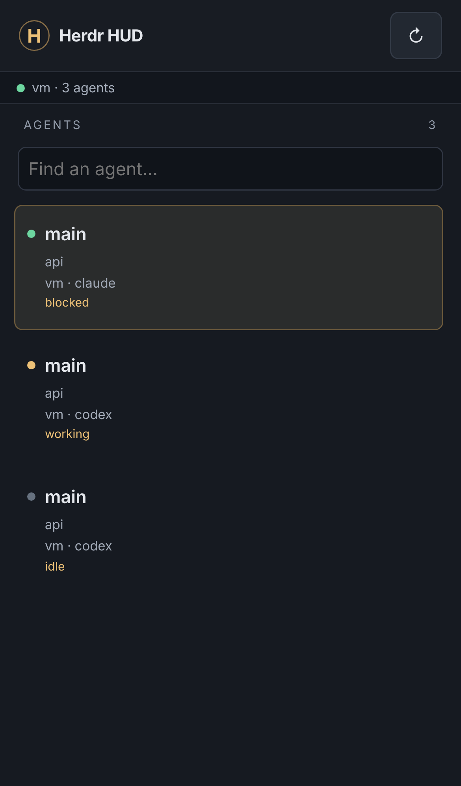
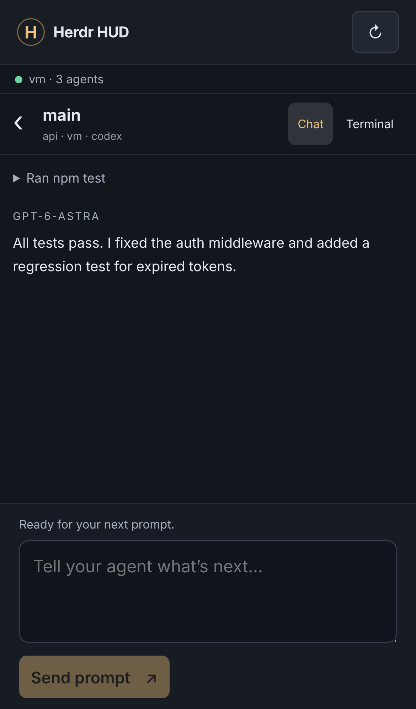

# Herdr HUD Mobile 📱

Message your [Herdr](https://herdr.dev) agents from your phone while you're scrolling Instagram or playing a game.

This is a phone version of [Herdr HUD](https://github.com/finna/herdr-hud), the desktop overlay that shows your agents over a game. It runs on the computer where Herdr runs and has two parts:

- **Phone HUD:** the same Herdr HUD agent list, chat view and prompt box, shown in your phone's browser. You can add it to your Home Screen so it opens like an app.
- **Telegram pings (optional):** you get a notification when an agent ✅ finishes or 🟡 needs you. The notification shows on top of Instagram or a game. Reply to it to prompt that agent, or tap a button to approve. A button in each ping opens the full HUD.

<p>


</p>

There's nothing to install: it's Python 3 using only the standard library. The bot doesn't open any public ports, and your agents never leave your computer.

## Setup

You need Herdr running with at least one agent ([Herdr HUD's getting-started guide](https://github.com/finna/herdr-hud/blob/main/docs/getting-started.md) covers that).

### 1. Run it on the computer where your agents run

```bash
git clone https://github.com/Saj8292008/Vibe-coding-.git herdr-hud-mobile
cd herdr-hud-mobile
python3 herdr_phone.py
```

It prints a private link, for example:

```
[herdr-phone] phone HUD — open on your phone, then Add to Home Screen:
    http://100.101.102.103:8787/?token=Zk3…
```

Before involving your phone, you can check that it can talk to herdr. This sends nothing to any agent:

```bash
python3 herdr_phone.py --check
```

### 2. Open the link on your phone

Your phone has to be able to reach the computer. Either option works:

- **[Tailscale](https://tailscale.com) (recommended):** install it on your computer and your phone and sign in to the same account. The link then works anywhere, on cellular too, and the connection is encrypted. If Tailscale is running, herdr-phone prints a `100.x.x.x` link automatically.
- **Same Wi-Fi:** use the link with your computer's local IP address. This only works at home, and traffic isn't encrypted on your Wi-Fi.

After the link opens:

- **iPhone (Safari):** tap Share, then **Add to Home Screen**.
- **Android (Chrome):** open the ⋮ menu, then tap **Add to Home screen** (or **Install app**).

The link is your password. After the first visit it's saved as a cookie, so the Home Screen icon opens straight to your agents.

### 3. (Optional) Turn on Telegram pings

With pings, you don't have to keep checking the HUD:

1. In Telegram, message [@BotFather](https://t.me/BotFather), send `/newbot`, and copy the token.
2. Run `cp .env.example .env` and paste the token in as `TELEGRAM_BOT_TOKEN=…`.
3. Run `python3 herdr_phone.py --whoami`, then send your bot any message. Put the `TELEGRAM_CHAT_ID=…` line it prints into `.env`.
4. Run `python3 herdr_phone.py` again.

## Using it

**In the HUD:** tap an agent to read its latest output. Codex output shows as chat; switch to **Terminal** to see the raw text. Type in the box and tap **Send prompt**. On a phone, Return adds a new line and only the button sends. The list updates every couple of seconds and refreshes as soon as you switch back from another app.

The HUD follows the same safety rules as the desktop app:

- Prompts only go to agents that are ready. A busy agent, or one waiting on an approval, won't take a prompt from the HUD.
- Every send first checks that it's still the same agent in that pane.
- If delivery is uncertain, your draft is kept.

**From a Telegram ping:**

| You do | What happens |
| --- | --- |
| Reply to a ping | Sends your reply as a prompt to that agent |
| Tap **1 / 2 / 3 / Enter / y / n / Esc / Ctrl‑C** | Sends that key to the agent, for approvals and menus |
| Tap **🖥 Open HUD** | Opens the full HUD |
| `/agents` | Lists your agents. Tap one to talk to it, then just type |
| `/read`, `/read 100` | Shows the agent's latest output |
| `/to 2 run the tests` | Sends one message to agent #2 |
| `/keys esc`, `/stop` | Sends keys, or interrupts the agent |
| `/hud` | Sends you the private HUD link |
| `/mute`, `/unmute` | Pauses or resumes pings |

Approvals work differently in the two places. In the HUD, answer them from Herdr itself, as the desktop HUD does. In Telegram, use the key buttons.

## Settings (`.env`)

| Variable | Default | Meaning |
| --- | --- | --- |
| `HUD_PORT` | `8787` | Port for the phone HUD. `0` turns it off |
| `HUD_HOST` | `0.0.0.0` | Address to listen on. Set `127.0.0.1` if you put it behind your own proxy |
| `HUD_PUBLIC_URL` | auto | The link to print and send, e.g. `http://desktop.your-tailnet.ts.net:8787` |
| `HUD_MACHINE_LABEL` | hostname | The name the HUD shows for this computer |
| `HUD_TOKEN` | random | Fixed secret instead of the generated one, which is stored in `~/.config/herdr-phone/hud-token` |
| `TELEGRAM_BOT_TOKEN` / `TELEGRAM_CHAT_ID` | – | Turns on Telegram pings. Messages from any other chat are ignored |
| `HERDR_PHONE_NOTIFY` | `blocked,done` | Which status changes ping you |
| `HERDR_SESSION` / `HERDR_SOCKET_PATH` | Herdr default | Which Herdr session to use |

To get a new HUD link and log out every phone, delete `~/.config/herdr-phone/hud-token` and restart.

## Keep it running

- **Easiest:** run it in a Herdr pane of its own.
- **Linux:** `cp herdr-phone.service ~/.config/systemd/user/ && systemctl --user enable --now herdr-phone`. Edit `WorkingDirectory` in the file if you cloned it somewhere other than `~/herdr-hud-mobile`.
- **macOS:** `nohup python3 herdr_phone.py > ~/herdr-phone.log 2>&1 &`

## Security

The HUD and the bot can type into your agents' terminals, so treat the link and the bot token like passwords.

- **HUD:** every request needs the secret link or the cookie it sets. The cookie is HttpOnly and SameSite=Strict, and actions also need a header that other websites can't send.
- **Telegram:** the bot only answers your chat id. Messages from anyone else are dropped without a reply.
- **Don't** forward port 8787 on your router. Use Tailscale instead.
- Telegram can see ping contents, which include recent agent output. Leave Telegram off if your agents print secrets; the HUD on its own never leaves your network.

## How it works

The desktop Herdr HUD is a native window, written in Swift or C#, that hosts a web UI. The web UI asks the native code for things like `ready`, `refresh`, `output` and `prompt`. This project is a third host for that same UI:

- `hud_server.py` answers those requests over HTTP and Server-Sent Events, using Herdr's socket API (`agent.list`, `agent.get`, `agent.read`, `agent.prompt`).
- `web/` is Herdr HUD's UI with a small HTTP bridge and a phone layout added. The desktop look and behavior are unchanged.
- `herdr_phone.py` starts the HUD server and runs the optional Telegram bot.

The phone HUD only sees the agents in the Herdr session on the computer it runs on. To cover more machines, run it on each one.

## Development

```bash
python3 -m unittest -v test_herdr_phone test_hud_server
node --test tests/*.test.cjs
```

The tests use a fake Herdr socket server, so they don't need Herdr, Telegram, or a network connection.

## Credits

The UI in `web/` comes from [finna/herdr-hud](https://github.com/finna/herdr-hud) (MIT, © 2026 Alex Finn). Its license is in [`web/LICENSE-herdr-hud`](web/LICENSE-herdr-hud).
